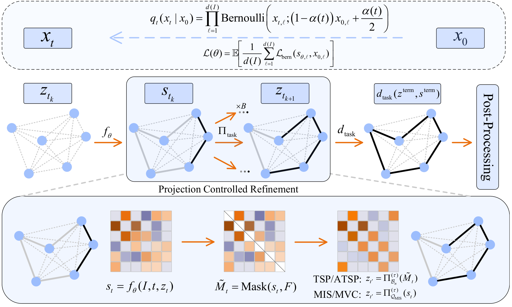

# RAGenCO: Relaxation-Aligned State Control for Test-Time Scaling in Generative Combinatorial Optimization

This repository contains the official implementation of the NeurIPS 2026 paper [RAGenCO: Relaxation-Aligned State Control for Test-Time Scaling in Generative Combinatorial Optimization](https://openreview.net/forum?id=dkHKGHN1xC).

Authors: [**Bohao Li**](https://53mins.github.io/BohaoLi/) (**Project lead**)  |  Yangming Guo  |  Pei He  |  Ying Li

## Abstract

Generative solvers for combinatorial optimization benefit from additional test-time compute when their refinement states remain aligned with task relaxations. We introduce RAGenCO, a relaxation-aligned test-time scaling framework for generative combinatorial optimization. The central idea is to treat projection onto a task relaxation as a state control primitive: refinement first maintains a projected control state, and only then forms the task-dependent decoder input or expands candidates. For TSP and ATSP, Sinkhorn projection aligns matrix states with the cycle-cover relaxation during refinement and decoding. For MIS and MVC, Bernoulli projection controls refinement on the independent-set side, while raw logits are retained for terminal greedy decoding because their ordering carries the decoder signal. Best-of-$B$ branching then reallocates compute by expanding candidates around aligned control states rather than sampling from unconstrained logits. Because these operations are used only at inference, the diffusion training objective remains unchanged. Under equal runtime budgets, this alignment of control state, decoder input, and branching yields a strong quality-runtime trade-off on TSP and ATSP and competitive results on MIS and MVC.



## Method

RAGenCO uses the same inference recipe across four combinatorial optimization tasks while changing the relaxation and decoder for each task.

- TSP and ATSP use masked Sinkhorn projection onto the cycle-cover relaxation. The final projected matrix is decoded into a tour with subtour repair and local improvement.
- MIS and MVC use Bernoulli entropic projection on the independent-set side to control refinement. The terminal greedy decoder keeps the raw-logit ordering, and MVC returns the complementary vertex cover.
- Anchor best-of-$B$ branching samples candidates around an aligned control state. Serial refinement depth $T_s$ and branch budget $B$ provide two independent inference-time compute knobs.

## ⚙️ Setup

The tested environment uses Python 3.8.20, PyTorch 2.0.1, PyTorch Lightning 1.9.5, and CUDA 11.8.

```bash
conda env create -f environment.yml
conda activate ragenco
```

For an existing Python 3.8 environment:

```bash
pip install -r requirements.txt
```

The PyTorch Geometric packages are CUDA-specific. If pip cannot resolve the matching wheels for `torch-scatter`, `torch-sparse`, `torch-cluster`, or `torch-spline-conv`, install wheels compatible with the local PyTorch and CUDA versions before installing the remaining requirements.

TSP decoding works without the optional Cython extension. To build the merge accelerator:

```bash
cd diffusion/utils/cython_merge
python setup.py build_ext --inplace
cd ../../..
```

## 📦 Data

RAGenCO uses the official train, validation, and test splits from [ML4CO-Bench-101](https://github.com/Thinklab-SJTU/ML4CO-Bench-101). The datasets are not included in this repository; pass their paths through the command line arguments described below.

TSP data is stored line by line as:

```text
x1 y1 x2 y2 ... xN yN output v1 v2 ... vN v1
```

ATSP data is stored as a flattened cost matrix followed by the reference tour:

```text
c11 c12 ... cNN output v1 v2 ... vN v1
```

MIS and MVC use one `.gpickle` graph per instance and a matching label file named `<graph_stem>_unweighted.result`. The conversion helper accepts linewise ML4CO graph text and writes this layout:

```bash
python scripts/convert_ml4co_txt_to_gpickle.py \
  --input /path/to/graphs.txt \
  --out-graph-dir /path/to/converted_data/rb_small_graphs \
  --out-label-dir /path/to/converted_data/rb_small_labels \
  --prefix rb_small
```

## 🏋️ Training

The entry points run training and can evaluate the resulting run in the same command with `--do_test`.

### TSP

```bash
python scripts/train_ragenco_tsp.py \
  --task tsp \
  --storage_path outputs/tsp100 \
  --training_split /path/to/tsp100_train.txt \
  --validation_split /path/to/tsp100_val.txt \
  --test_split /path/to/tsp100_test.txt \
  --do_train --do_test \
  --batch_size 1024 \
  --num_epochs 800 \
  --learning_rate 2e-4 \
  --lr_warmup_steps 1000
```

### ATSP

```bash
python scripts/train_ragenco_atsp.py \
  --task atsp \
  --storage_path outputs/atsp50 \
  --training_split /path/to/atsp50_train.txt \
  --validation_split /path/to/atsp50_val.txt \
  --test_split /path/to/atsp50_test.txt \
  --do_train --do_test \
  --batch_size 1024 \
  --num_epochs 600 \
  --learning_rate 2e-4 \
  --lr_warmup_steps 1000
```

### MIS

```bash
python scripts/train_ragenco_mis.py \
  --task mis \
  --storage_path outputs/mis_rb_small \
  --training_split '/path/to/rb_small_train/*.gpickle' \
  --training_split_label_dir /path/to/rb_small_train_labels \
  --validation_split '/path/to/rb_small_val/*.gpickle' \
  --validation_split_label_dir /path/to/rb_small_val_labels \
  --test_split '/path/to/rb_small_test/*.gpickle' \
  --test_split_label_dir /path/to/rb_small_test_labels \
  --do_train --do_test \
  --batch_size 256 \
  --num_epochs 400 \
  --learning_rate 2e-4 \
  --lr_warmup_steps 1000
```

### MVC

```bash
python scripts/train_ragenco_mvc.py \
  --task mvc \
  --storage_path outputs/mvc_rb_small \
  --training_split '/path/to/rb_small_train/*.gpickle' \
  --training_split_label_dir /path/to/rb_small_train_labels \
  --validation_split '/path/to/rb_small_val/*.gpickle' \
  --validation_split_label_dir /path/to/rb_small_val_labels \
  --test_split '/path/to/rb_small_test/*.gpickle' \
  --test_split_label_dir /path/to/rb_small_test_labels \
  --do_train --do_test \
  --batch_size 256 \
  --num_epochs 400 \
  --learning_rate 2e-4 \
  --lr_warmup_steps 1000
```

## 🎛️ Inference controls

- `--inference_diffusion_steps` sets the serial refinement depth for TSP and ATSP.
- `--mis_refine_steps` and `--mvc_refine_steps` set the refinement depth for MIS and MVC.
- `--branch_budget` sets the anchor best-of-$B$ candidate budget.
- Sinkhorn projection is enabled by default for TSP and ATSP. Use `--no_sinkhorn` to disable it.
- Bernoulli entropic projection is enabled by default for MIS and MVC. Use `--no_mis_entropic_projection` or `--no_mvc_entropic_projection` to disable it.
- `--node_decode_source raw_logits` selects the default terminal decoder input for MIS and MVC.

## 🙏 Acknowledgements

RAGenCO is partly built on [DIFUSCO](https://github.com/Edward-Sun/DIFUSCO), [Fast T2T](https://github.com/Thinklab-SJTU/Fast-T2T), and [ML4CO-Bench-101](https://github.com/Thinklab-SJTU/ML4CO-Bench-101). We thank the authors for making these resources available.

## 📝 Citation

If you find RAGenCO useful in your research, please cite:

```bibtex
@inproceedings{li2026ragenco,
  title={Relaxation-Aligned State Control for Test-Time Scaling in Generative Combinatorial Optimization},
  author={Bohao Li and Yangming Guo and Pei He and Ying Li},
  booktitle={The Fortieth Annual Conference on Neural Information Processing Systems},
  year={2026}
}
```
